  

  
  
  
  

dropped out of college. now i build full time and let SI write most of the code.

### what i'm running

| | |
|---|---|
| 🔥 **[J&T](https://jtsolutions.ai)** | custom SI systems built inside established businesses. 25+ companies run on stuff we built |
| 🔥 **[GTM](https://trygtm.com)** | finds people who are already looking, writes to them, books the call |
| 🔥 **[Lumina](https://luminasales.io)** | **fulfillment.** agencies sell the build under their name, we build it, they keep the margin |
| 🔥 **[Diced](https://diced.si)** | intent leads, pay per lead. way cheaper than apollo or clay |

i coach inside of [AI Frontrunners](https://timchao.ai) w/ [tim chao](https://x.com/timchaoai).

### stack

  

  <picture>
    <source media="(prefers-color-scheme: dark)" srcset="https://raw.githubusercontent.com/joe-bren/joe-bren/output/snake-dark.svg" />
    
  </picture>

